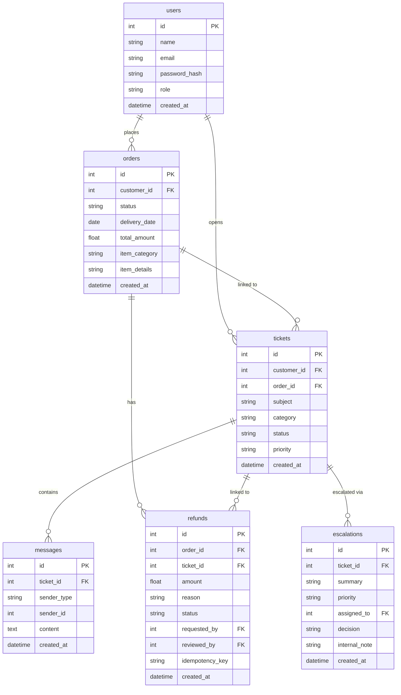
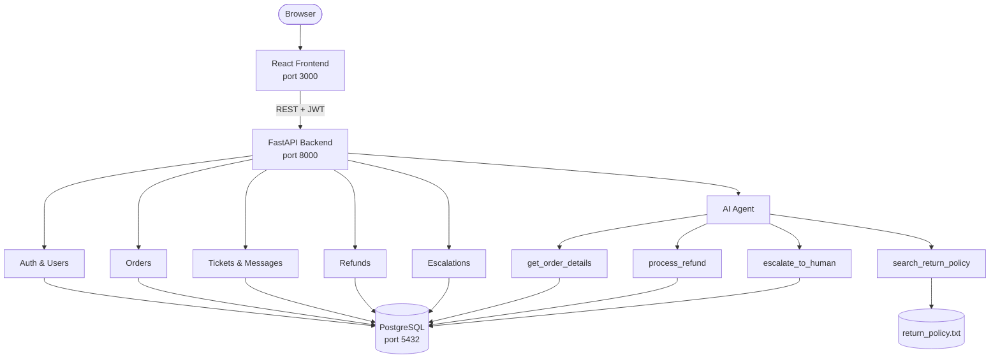

# ShopCare AI — E-Commerce AI Customer Support

Full-stack AI-powered customer support system. Customers chat with an AI agent, raise tickets, request refunds, and track resolutions. Staff review escalations and approve/reject high-value refunds.

## Tech Stack

| Layer | Tech |
|-------|------|
| Frontend | React 18 + TypeScript + Vite |
| Backend | Python 3.11 + FastAPI |
| Database | PostgreSQL 15 |
| Auth | JWT (python-jose + bcrypt) |
| AI Agent | Rule-based mock LLM (drop-in for Gemini/OpenAI) |
| Deployment | Docker + Docker Compose |

## Key Features

- **Order Creation** — Authenticated customers can create orders via UI modal (`POST /orders/`)
- **In-Chat Refund Form** — Refund form appears in chat when customer mentions refund; shows live ≤/> ₹5,000 indicator
- **Auto-Approval** — Refunds ≤ ₹5,000 are automatically approved; > ₹5,000 are escalated to staff
- **Multi-turn AI Agent** — Context-aware chat with 4 tools: `get_order_details`, `search_return_policy`, `process_refund`, `escalate_to_human`
- **Prompt Injection Detection** — Agent guards against adversarial inputs with audit logging
- **System Notifications** — After refund submission, a system message appears in the ticket conversation
- **Role-based Access** — Customer / Staff / Admin roles with JWT-secured endpoints

## Business Rules

| Rule | Detail |
|------|--------|
| Return window | 7 days from delivery date |
| Auto-approval | Refunds ≤ ₹5,000 → status: `approved` immediately |
| Escalation | Refunds > ₹5,000 → status: `escalated`, creates Escalation record |
| Idempotency | Duplicate refund requests blocked via idempotency key |
| Ownership | Customers can only access their own orders and tickets |

## ER Diagram



## Architecture



## Quick Start (Docker)

```bash
git clone <repo-url>
cd ecommerce-ai-support
cp .env.example .env        # set SECRET_KEY and POSTGRES_PASSWORD
docker compose up --build
```

- Frontend: http://localhost:3000
- API Docs: http://localhost:8000/docs

## Running Locally

**Backend**
```bash
cd backend
python -m venv venv
venv\Scripts\activate          # Windows
pip install -r requirements.txt
cp .env.example .env           # set DATABASE_URL
python migrations/init_db.py
python seed/seed_data.py
uvicorn app.main:app --reload --port 8000
```

**Frontend**
```bash
cd frontend
npm install
npm run dev                    # http://localhost:5173
```

## Test Accounts

| Role | Email | Password |
|------|-------|----------|
| Customer | rahul@example.com | test1234 |
| Customer | priya@example.com | test1234 |
| Staff | agent@support.com | staff1234 |
| Admin | admin@support.com | admin1234 |

## Running Tests

```bash
cd backend
pytest tests/ -v
```

> Requires a local PostgreSQL database named `ecommerce_support_test`.

## AI Provider Note

The agent uses a rule-based mock LLM — no API key needed. To swap in a real LLM:
1. Install `google-generativeai` or `openai`
2. Replace `mock_llm_response()` in `backend/app/agent/agent_core.py`
3. Add your API key to `.env`
