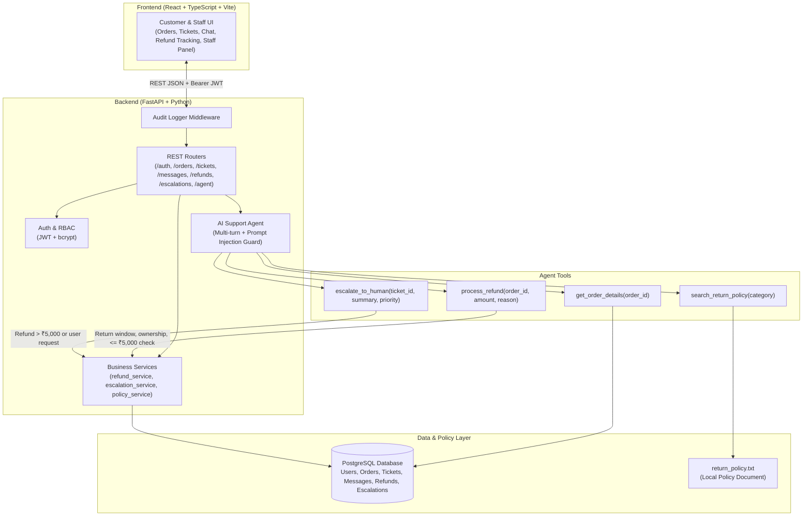

# System Architecture

This document outlines the architecture of the **AI-Powered E-commerce Customer Support System**, covering the frontend, backend API, AI agent tools, database, and human-review escalation workflow.

## Request & Escalation Flow

1. **Customer Authentication**: Customer registers or logs in via `/auth/login` and receives a JWT token.
2. **Ticket & Chat**: Customer creates a support ticket and sends messages to `/agent/chat` or `/messages/`.
3. **AI Agent Guardrails**:
   - Checks for prompt injection attempts before routing.
   - Asks for missing order IDs before calling order/refund tools.
   - Enforces order ownership (`order.customer_id == current_user.id`).
4. **Refund Validation & Escalation**:
   - Backend validates delivered status, 7-day return window, order total cap, and idempotency key.
   - Refunds **≤ ₹5,000** are created in `pending` state.
   - Refunds **> ₹5,000** automatically create an `Escalation` record and set ticket status to `pending_review`.
5. **Human Staff Review**: Staff members log into the Staff Panel (`/staff`) to approve, reject, or request more info on escalated cases.
